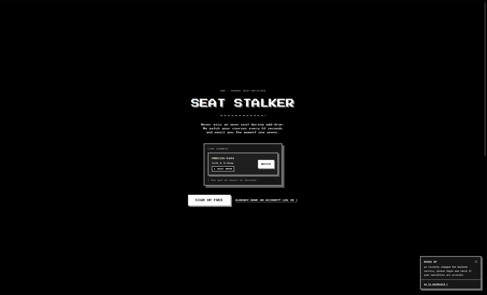
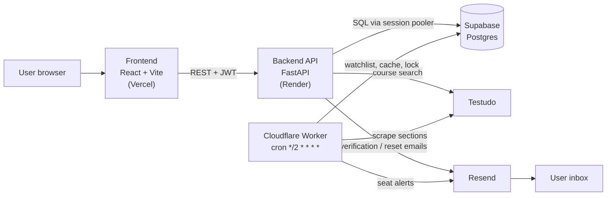

# SeatStalker

Get an email the moment a seat opens in a full University of Maryland course section.

**Live demo:** https://seat-stalker.vercel.app



## The problem

During add/drop at UMD, seats in full sections open up at random times and are taken within minutes. Testudo, the university's schedule site, doesn't notify anyone, so students end up refreshing the page for days. SeatStalker watches the sections you care about and emails you as soon as one has an open seat.

## Features

- **Sign-up and sign-in.** Email-verified registration (6-digit code), JWT sessions, and password reset by emailed link.
- **Personal watchlist.** Search a course (e.g. `CMSC131`), see every section with open seats, instructors, and meeting times, and watch up to 5 sections.
- **Polling every 2 minutes.** A scheduled Cloudflare Worker checks watched sections against Testudo.
- **Email alerts.** One email per availability window, sent to your registered address. The alert re-arms when the section fills up again.
- **Hashed passwords.** Passwords are stored as bcrypt hashes, and verification/reset codes are stored as SHA-256 hashes.
- **Rate limiting.** Login, registration, and reset endpoints are rate-limited per IP.

## Architecture



- **Frontend (Vercel):** React SPA for search, watchlist management, and auth. It talks only to the backend.
- **Backend (Render):** FastAPI service that handles auth, the watchlist, and live course search (scrapes Testudo). It connects to Supabase Postgres with `psycopg2`.
- **Poller (Cloudflare Worker):** runs every 2 minutes. It takes a short lease lock in Postgres (so overlapping runs don't double-send), reads the watchlist, scrapes the relevant Testudo course pages, updates `section_cache`, and sends alerts through the Resend batch API. Large watchlists are processed in rotating batches of 30 courses, and newly added watches are checked on every run.
- **Database (Supabase):** Postgres holds users, watchlists, the section cache, hashed one-time codes, and poller state/lock.

## Tech stack

| Layer | Tech |
| --- | --- |
| Frontend | React 19, Vite 8, React Router 7, Tailwind CSS 3, Framer Motion, Axios |
| Backend | Python, FastAPI, Uvicorn, psycopg2, BeautifulSoup, python-jose (JWT), bcrypt, SlowAPI, Resend |
| Poller | Cloudflare Workers (TypeScript), Wrangler, `@supabase/supabase-js` |
| Database | Supabase (PostgreSQL) |
| Email | Resend |
| CI/CD | GitHub Actions (Worker deploy), Vercel and Render Git integrations |

## Engineering decisions

- **From an always-on poller to a scheduled Worker.** The poller originally ran as an always-on Python process on Fly.io, which meant paying for and babysitting a 24/7 server just to run a loop. I redesigned it as a Cloudflare Worker with a cron trigger. That keeps 2-minute polling at no cost and removes the need for a long-running server. Because Workers have per-invocation time limits, the Worker uses a database lock to prevent overlapping runs and a rotating cursor to spread large watchlists across invocations.
- **Session pooler for Postgres.** Render's free tier can't reach Supabase's IPv6-only direct host, so the backend connects through Supabase's IPv4 session pooler. The Worker uses Supabase's HTTPS API, so it needs no TCP connection at all.
- **One alert per opening.** Each watch has a `notified_at` timestamp. It is set when an alert is sent and cleared when the section fills up again, so users get one email per opening instead of an email every 2 minutes.

## How passwords are handled

Passwords are hashed with the [`bcrypt`](https://pypi.org/project/bcrypt/) library (`bcrypt.hashpw` with a per-password salt from `bcrypt.gensalt()`) and checked with `bcrypt.checkpw`. Plaintext passwords are never stored or logged. Registration codes and password-reset tokens are random values (`secrets` module), stored only as SHA-256 hashes, and expire after 15 minutes. Sessions are HS256 JWTs signed with `JWT_SECRET` and valid for 7 days.

## Local setup

### Prerequisites

- Python 3.10+
- Node.js 20.19+ and npm
- PostgreSQL (local) for the backend
- A Supabase project for the poller (it uses Supabase's HTTP API, so a plain local Postgres isn't enough)
- Optional: a [Resend](https://resend.com) API key. Without one, the backend prints emails to the console.

### 1. Clone and configure

```bash
git clone https://github.com/Snek3471/SeatStalker.git
cd SeatStalker

cp .env.example .env                       # backend
cp frontend/.env.example frontend/.env     # frontend
cp poller/.dev.vars.example poller/.dev.vars  # poller (Worker)
```

Fill in the values. Each variable is described in its example file.

### 2. Database

Create a database and apply the schema (it includes the poller's state table and lock functions):

```bash
createdb seatstalker
psql "$DATABASE_URL" -f schema.sql
```

For Supabase, paste `schema.sql` into the SQL editor (or apply `supabase/migrations/` for an existing database).

### 3. Backend (FastAPI) on http://localhost:8000

```bash
python -m venv .venv
source .venv/bin/activate        # Windows: .venv\Scripts\activate
pip install -r requirements.txt
uvicorn main:app --reload
```

Interactive API docs: http://localhost:8000/docs

### 4. Frontend (React) on http://localhost:5173

```bash
cd frontend
npm install
npm run dev
```

### 5. Poller (Cloudflare Worker)

```bash
cd poller
npm install
npm run dev        # wrangler dev --test-scheduled
```

Trigger a scheduled run locally:

```bash
curl "http://localhost:8787/__scheduled?cron=*/2+*+*+*+*"
```

You can also use the protected manual endpoint:

```bash
curl -X POST http://localhost:8787/run -H "Authorization: Bearer $POLL_SECRET"
```

### Checks

```bash
cd frontend && npm run lint && npm run build
cd poller && npm run typecheck
```

`scratch/test_api_external.py` is an end-to-end smoke test for a running local backend (`python scratch/test_api_external.py`). It creates two test users in the configured database.

## Deployment

| Part | Platform | Notes |
| --- | --- | --- |
| Database | Supabase | Run `schema.sql` once. Use the **session pooler** connection string for the backend's `DATABASE_URL`. |
| Backend | Render (web service) | Deploy from the root `Dockerfile`. Render provides `PORT`. Set `DATABASE_URL`, `JWT_SECRET`, `RESEND_API_KEY`, `RESEND_SENDER_EMAIL`, `FRONTEND_URL` (your Vercel URL), and `UMD_SEMESTER`. `CORS_ORIGIN_REGEX` is optional. |
| Frontend | Vercel | Root directory `frontend`, Vite preset. Set `VITE_API_URL` to the Render URL (no trailing slash) and redeploy after changing it. `vercel.json` rewrites all routes to the SPA. |
| Poller | Cloudflare Workers | Cron is defined in `poller/wrangler.jsonc`. Set secrets once with `npx wrangler secret put <NAME>` for `SUPABASE_URL`, `SUPABASE_SERVICE_ROLE_KEY`, `RESEND_API_KEY`, `RESEND_SENDER_EMAIL`, `POLL_SECRET` (and optionally `HEALTHCHECK_URL`). `.github/workflows/deploy-worker.yml` deploys on pushes to `poller/**` using the `CLOUDFLARE_API_TOKEN` and `CLOUDFLARE_ACCOUNT_ID` repository secrets. |

The semester is set by `UMD_SEMESTER` (backend env var and `vars` in `wrangler.jsonc`). Update both each term.

## API overview

| Method | Path | Auth | Purpose |
| --- | --- | --- | --- |
| `POST` | `/auth/register/send-otp` | – | Email a 6-digit verification code |
| `POST` | `/auth/register` | – | Create account (code + password) |
| `POST` | `/auth/login` | – | Returns a JWT |
| `POST` | `/auth/password-reset/request` | – | Email a reset link |
| `POST` | `/auth/password-reset/confirm` | – | Set a new password |
| `GET` | `/courses/{course_id}/sections` | – | Live section data for a course |
| `GET` | `/watchlist` | JWT | List your watched sections |
| `POST` | `/watchlist` | JWT | Watch a section (`{"section_id": "CMSC131-0101"}`) |
| `DELETE` | `/watchlist` | JWT | Stop watching a section |

## Author

<!-- TODO: add your name and a contact/portfolio link -->
Built by **Harshith Bachimanchi** · [harshith@umd.edu](mailto:harshith@umd.edu)

## License

[MIT](LICENSE)
